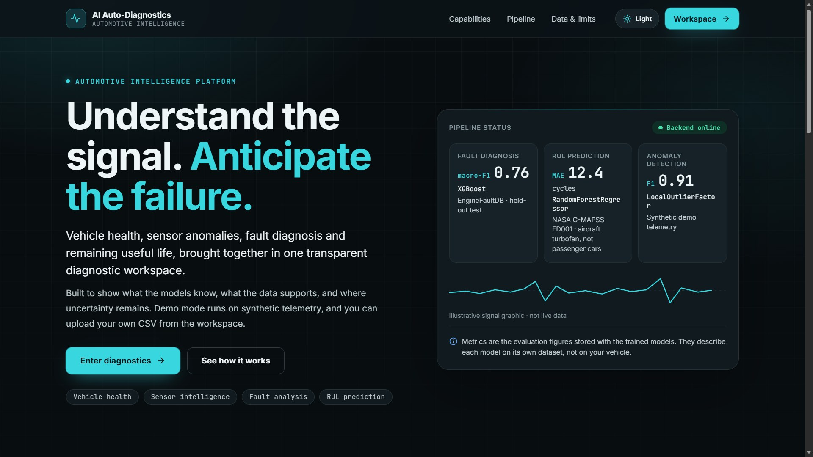
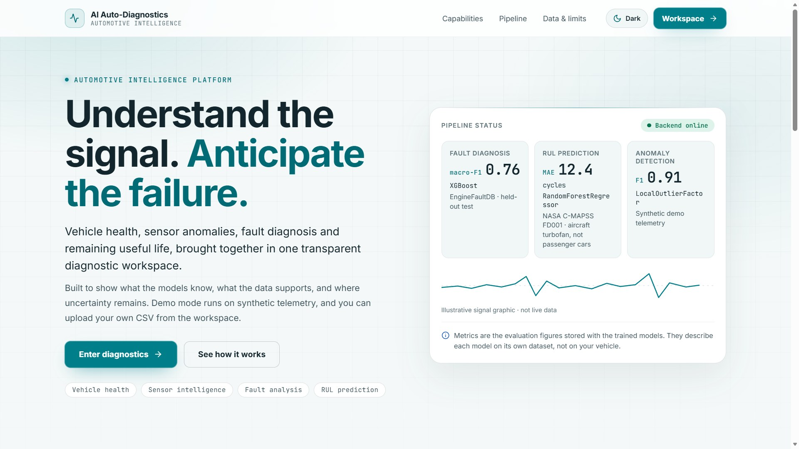
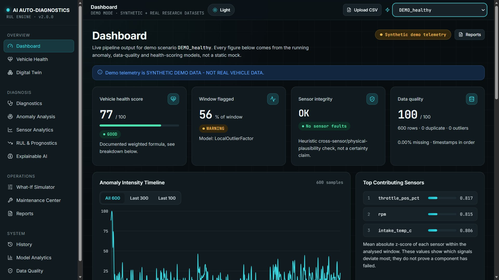
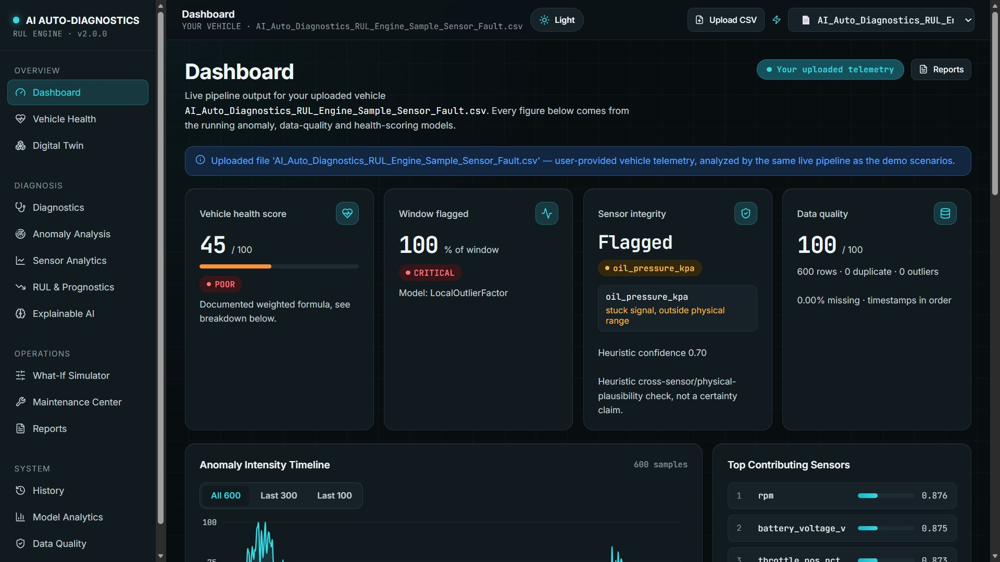
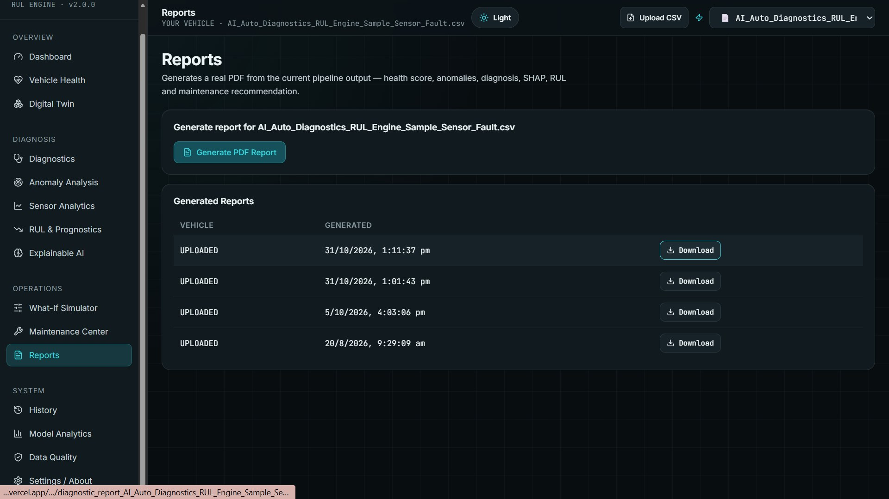
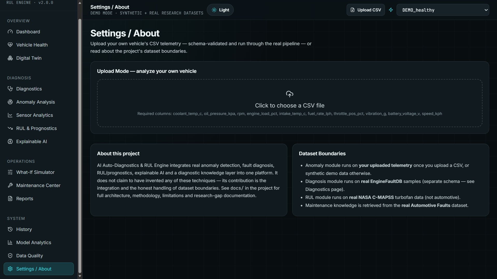

# AI Auto-Diagnostics & RUL Engine

### AI-powered vehicle health monitoring, fault diagnosis, anomaly detection, predictive maintenance, and Remaining Useful Life (RUL) estimation.

**Detect. Diagnose. Predict. Protect.**

[](https://ai-auto-diagnostics.vercel.app/)
[](https://ai-auto-diagnostics-backend.onrender.com/docs)
[](https://ai-auto-diagnostics.vercel.app/)
[](https://www.python.org/)
[](#)

> **Live application:** https://ai-auto-diagnostics.vercel.app/  
> **Backend API documentation:** https://ai-auto-diagnostics-backend.onrender.com/docs

---

## Overview

AI Auto-Diagnostics & RUL Engine is a full-stack automotive intelligence platform that brings several data-driven diagnostics and predictive-maintenance workflows into one interface. It combines data-quality checks, sensor anomaly analysis, fault diagnosis, vehicle-health scoring, Remaining Useful Life (RUL) prognostics, explainable AI (SHAP), and knowledge-based maintenance recommendations.

The platform is designed to act like an **“AI doctor for a vehicle”**: it helps surface unusual sensor behaviour, investigate probable faults, understand model outputs, and explore maintenance priorities.

The project integrates multiple datasets, models, and analysis methods while documenting the boundaries of each dataset. It does **not** treat aircraft-engine data as passenger-car data, or synthetic demo telemetry as real fleet data.

## Live Demo

Open the deployed application:

**[Launch AI Auto-Diagnostics & RUL Engine](https://ai-auto-diagnostics.vercel.app/)**

The frontend is hosted on Vercel and the FastAPI backend is hosted on Render. On the free backend tier, the service may spin down after inactivity, so the first request after a quiet period can take longer than usual.

## Screenshots

### Welcome page — dark theme


### Welcome page — light theme


### Dashboard — synthetic demo telemetry


### Dashboard — uploaded telemetry


### Reports — generated PDF reports


### Settings / About — CSV upload and dataset boundaries


---

## Key Features

- **Vehicle health monitoring:** Displays a health score and supporting indicators from the analysis pipeline.
- **Sensor anomaly analysis:** Identifies unusual sensor behaviour using the configured anomaly-detection workflow.
- **Sensor-fault analysis:** Uses cross-sensor and physical-plausibility checks to flag possible sensor faults.
- **Fault diagnosis:** Runs the trained diagnosis model on supported EngineFaultDB samples.
- **RUL and prognostics:** Estimates remaining useful life using the trained NASA C-MAPSS FD001 model and clearly identifies the aircraft-engine data context.
- **Explainable AI:** Presents SHAP-based feature contributions to help interpret diagnosis model outputs.
- **What-If simulator:** Lets users explore how changing input sensor values affects supported predictions.
- **Maintenance knowledge:** Retrieves relevant maintenance information from the Automotive Faults dataset.
- **CSV upload mode:** Validates a user-provided telemetry CSV against the expected schema and runs supported analysis.
- **PDF reports:** Generates downloadable reports from the current analysis, including relevant health, anomaly, diagnosis, SHAP, RUL, and maintenance information.
- **History and model analytics:** Provides views for available analysis records and stored model-evaluation metrics.
- **Dark and light themes:** Includes a responsive interface with persistent theme selection.

## Application Pages

Dashboard · Vehicle Health · Digital Twin · Diagnostics · Anomaly Analysis · Sensor Analytics · RUL & Prognostics · Explainable AI · What-If Simulator · Maintenance Center · Reports · History · Model Analytics · Data Quality · Settings/About.

## Architecture

```text
                  ┌──────────────────────────────┐
                  │       React + Vite           │
                  │  Dashboard, charts, pages,   │
                  │  CSV upload, PDF report UI   │
                  └──────────────┬───────────────┘
                                 │ /api/*
                                 ▼
                  ┌──────────────────────────────┐
                  │         FastAPI              │
                  │  API routes and orchestration│
                  └──────────────┬───────────────┘
                                 │
          ┌──────────────────────┼──────────────────────┐
          ▼                      ▼                      ▼
 ┌────────────────┐   ┌────────────────────┐   ┌──────────────────┐
 │ Data validation│   │ ML inference       │   │ Maintenance      │
 │ and feature    │   │ anomaly / diagnosis│   │ knowledge lookup │
 │ engineering    │   │ / RUL / SHAP       │   │ and PDF reports  │
 └────────────────┘   └────────────────────┘   └──────────────────┘
          │                      │                      │
          └──────────────────────┴──────────────────────┘
                                 ▼
                  ┌──────────────────────────────┐
                  │ SQLite history and generated │
                  │ report files (deployment     │
                  │ persistence depends on host)│
                  └──────────────────────────────┘
```

For the detailed architecture, data flow, and component responsibilities, see [`docs/architecture.md`](docs/architecture.md).

## Datasets and Their Roles

Each dataset is used only for the task and scope it supports.

| Dataset | Role in this project | Scope / status |
|---|---|---|
| EngineAD | Research reference for engine anomaly detection | The paper is referenced; the real fleet dataset is access-gated and is not included. See `docs/dataset_sources.md`. |
| EngineFaultDB | Fault diagnosis | Included real dataset used to train and evaluate the diagnosis model. Fault classes 1–3 are kept under their source labels because descriptive names are not provided in the source file. |
| NASA C-MAPSS FD001 | RUL / prognostics methodology | Included real aircraft turbofan dataset. It is **not passenger-car data**. |
| Automotive Faults Dataset | Maintenance knowledge retrieval | Used to retrieve documented maintenance information; retrieval does not itself generate a diagnosis. |
| Synthetic demo telemetry | Demo Mode | Generated telemetry used to exercise the end-to-end demo workflow. It is labelled as synthetic in the application. |

More detail: [`docs/dataset_sources.md`](docs/dataset_sources.md), [`docs/dataset_feature_mapping.md`](docs/dataset_feature_mapping.md), and [`docs/limitations.md`](docs/limitations.md).

## Machine-Learning Methodology and Evaluation

The repository includes trained models and evaluation documentation. The dashboard and model-analytics views present the metrics stored with the models; those evaluation figures describe their corresponding evaluation datasets, not a guarantee about an individual vehicle.

| Module | Methodology | Reported evaluation context |
|---|---|---|
| Anomaly detection | Isolation Forest / One-Class SVM / Local Outlier Factor benchmark | LOF F1 is approximately **0.91 on synthetic demo telemetry**; it should not be interpreted as validated real-fleet performance. |
| Fault diagnosis | Logistic Regression / Random Forest / SVM / XGBoost benchmark on EngineFaultDB; XGBoost selected | Held-out test macro-F1 is approximately **0.75**. |
| RUL / prognostics | Random Forest / Gradient Boosting / XGBoost regression on NASA C-MAPSS FD001, with unit-level split | MAE is approximately **12.4 cycles**; the source data is aircraft turbofan data. |
| Vehicle health score | Disclosed additive scoring formula | See `docs/methodology.md` for the formula and its interpretation. |
| Maintenance knowledge | Keyword/category retrieval over the Automotive Faults dataset | Retrieves documented entries; it does not create or validate a fault diagnosis. |

For exact metrics, experimental setup, and limitations, consult [`docs/model_evaluation.md`](docs/model_evaluation.md) and [`docs/methodology.md`](docs/methodology.md).

## Modes of Operation

### Demo Mode
The default mode uses generated synthetic telemetry scenarios, including healthy operation, increasing anomaly severity, sensor faults, progressive degradation, and multiple abnormalities. Demo outputs are labelled as synthetic.

### Research Mode
The Diagnostics workflow can draw supported real samples from EngineFaultDB. The RUL workflow uses NASA C-MAPSS engine units and identifies the aircraft turbofan context.

### Upload Mode
Users can upload a telemetry CSV. The application validates the expected schema and reports missing or invalid required columns before running the supported pipeline.

The demo telemetry, EngineFaultDB, and NASA C-MAPSS have different feature spaces and roles. They are not merged into one training dataset.

## CSV Upload Schema

The current upload workflow expects these columns:

```text
coolant_temp_c
oil_pressure_kpa
rpm
engine_load_pct
intake_temp_c
fuel_rate_lph
throttle_pos_pct
vibration_g
battery_voltage_v
speed_kph
```

Use the sample CSV supplied in the repository, where available, as a starting point. Upload only data you are authorized to use, and avoid including personal or sensitive information.

## Tech Stack

**Frontend**
- React
- Vite
- JavaScript
- Responsive CSS and theme tokens
- Charts and interactive dashboard components

**Backend**
- Python
- FastAPI
- Uvicorn
- SQLite for local application history

**Machine Learning and Explainability**
- scikit-learn
- XGBoost
- SHAP
- pandas / NumPy

**Reporting and Deployment**
- ReportLab for PDF generation
- Vercel for the frontend
- Render for the backend
- GitHub for source control

See `frontend/package.json` and `backend/requirements.txt` for the project dependency lists.

## Getting Started Locally

### Prerequisites

- Python 3.10 or later
- Node.js 18 or later
- Git

### 1. Clone the repository

```bash
git clone https://github.com/HVD02/AI-Auto-Diagnostics-RUL-Engine.git
cd AI-Auto-Diagnostics-RUL-Engine
```

### 2. Start the backend

Create and activate a virtual environment from the repository root.

**Windows PowerShell:**

```powershell
python -m venv .venv
.\.venv\Scripts\Activate.ps1
pip install -r backend\requirements.txt

$env:PYTHONPATH = "$(Get-Location);$(Join-Path (Get-Location) 'backend')"
python -m uvicorn backend.main:app --reload --host 127.0.0.1 --port 8000
```

**macOS / Linux:**

```bash
python3 -m venv .venv
source .venv/bin/activate
pip install -r backend/requirements.txt
PYTHONPATH="$(pwd):$(pwd)/backend" python -m uvicorn backend.main:app --reload --host 127.0.0.1 --port 8000
```

Backend API documentation: http://127.0.0.1:8000/docs

### 3. Start the frontend

Open a second terminal:

```bash
cd frontend
npm install
npm run dev
```

Open the local frontend URL printed by Vite (normally http://localhost:5173).

The Vite development server proxies `/api` requests to the local FastAPI backend. Keep both development servers running while using the application.

### 4. Retraining and data preparation

The repository includes scripts for data preparation, demo-data generation, model training, and evaluation. Run them from the repository root when the required datasets and dependencies are available:

```bash
python scripts/prepare_data.py
python scripts/generate_demo_data.py
python scripts/train_diagnosis.py
python scripts/train_rul.py
python scripts/train_anomaly.py
python scripts/evaluate_models.py
```

The trained model files are included under `backend/model/`. Review the individual scripts and dataset documentation before retraining.

## Tests

Install the backend requirements and test dependencies, then run from the repository root:

```bash
python -m pip install -r backend/requirements.txt
python -m pip install pytest httpx
python -m pytest tests/ -v
```

The test suite covers data loading, feature engineering, model workflows, health scoring, sensor-fault detection, maintenance retrieval, and API behaviour. The exact set of tests may evolve; use the current test run as the source of truth.

## Deployment

The current public demo is deployed as:

- **Frontend:** Vercel — https://ai-auto-diagnostics.vercel.app/
- **Backend:** Render — https://ai-auto-diagnostics-backend.onrender.com/
- **API docs:** https://ai-auto-diagnostics-backend.onrender.com/docs

The Vercel frontend uses the repository's `frontend/vercel.json` rewrite configuration to forward `/api/*` and `/static/*` requests to the Render backend.

### Hosting notes

- Render free web services can spin down after inactivity, so the first request after a quiet period may be delayed.
- The default filesystem of a free hosting instance should not be treated as durable storage. SQLite updates, uploaded files, and generated reports may not survive restarts or redeployments unless persistent storage or an external database/object store is configured.
- For a persistent production deployment, configure durable storage and appropriate backups before relying on long-term history or report retention.

## Limitations and Responsible Use

- EngineAD's real fleet data is access-gated and is not included in this repository; the demo anomaly workflow uses synthetic telemetry.
- EngineFaultDB fault classes 1–3 are not assigned descriptive names in the source data, so the application retains the source class labels.
- NASA C-MAPSS FD001 is aircraft turbofan data, not passenger-car data. The application labels this boundary and does not present the dataset as automotive training data.
- Demo telemetry and the EngineFaultDB / C-MAPSS datasets represent different feature spaces and are not merged.
- Model metrics are dataset-specific evaluation results, not guarantees of real-world vehicle performance.
- Sensor plausibility checks and model outputs are diagnostic aids, not proof that a physical component has failed.

**Safety disclaimer:** This system is an educational and research demonstration. It does not replace inspection by a qualified automotive technician and must not be used as the sole basis for safety-critical maintenance decisions.

## Research Gap and Future Scope

The project does not claim to have invented anomaly detection, fault diagnosis, RUL prediction, XGBoost, SHAP, or predictive maintenance. Its contribution is the integration of these workflows into a modular platform with explicit dataset boundaries and transparent reporting.

Potential future work includes:
- Access to and integration of real fleet-level EngineAD data, subject to permission.
- Vehicle-specific baselines and validation on automotive RUL datasets.
- Data-drift monitoring and model recalibration.
- Durable storage for histories, uploads, and generated reports.
- Broader evaluation with real-world vehicles and expert-reviewed fault labels.

See [`docs/research_gap.md`](docs/research_gap.md) and [`docs/future_scope.md`](docs/future_scope.md).

## References

- Hojjati et al., *EngineAD: A Real-World Vehicle Engine Anomaly Detection Dataset*, arXiv:2603.25955.
- [EngineFaultDB](https://github.com/leoxthomas/EngineFaultDB).
- [NASA C-MAPSS simulated turbofan engine data](https://data.nasa.gov/dataset/cmapss-jet-engine-simulated-data).
- [Automotive Faults Dataset — Zenodo record 15626055](https://zenodo.org/records/15626055).

## Project Documentation

Explore the `docs/` directory for:
- Architecture and pipeline walkthrough
- Dataset sources and feature mapping
- Model methodology and evaluation
- Limitations and research gap
- Future scope

---

**Built to make model behaviour, dataset boundaries, and diagnostic uncertainty visible — not to hide them behind a dashboard.**
